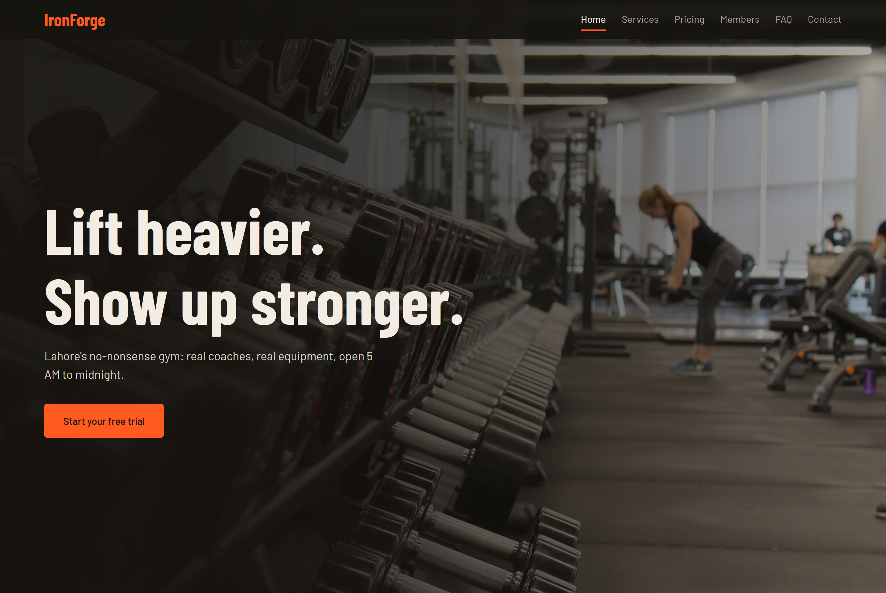
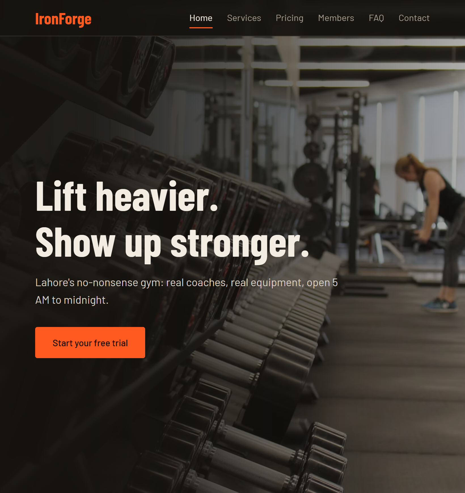
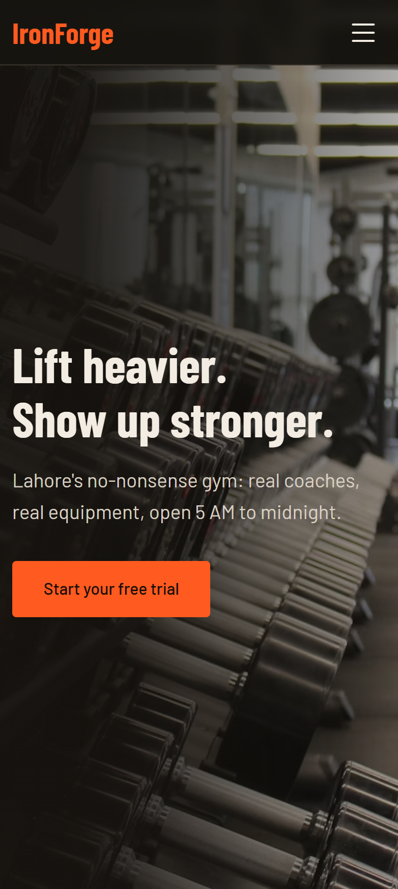
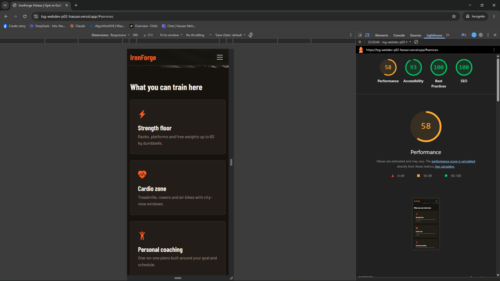

# IronForge Fitness: Responsive Business Landing Page

Project 02 (Web Development, Beginner) for The Sky Gen.
Built by Hassan Mehmood, Batch ID: YOUR_BATCH_ID

**Live site:** https://tsg-webdev-p02-hassan.vercel.app/
**GitHub:** https://github.com/hasssan0777/tsg-webdev-p02-hassan

## Business concept
IronForge Fitness is a fictional gym in Gulberg III, Lahore. It targets young professionals who want serious strength training with real coaching. The page's goal is to turn visitors into free-trial sign-ups.

## Features
- Sticky navigation, smooth scroll, active-link highlight
- Hero with background image and call-to-action
- 6 service cards with icons and hover effects
- 3 pricing plans, "Pro" highlighted
- Testimonials slider (arrows and dots)
- FAQ accordion (5 questions)
- Contact form with validation and embedded Google Map
- Footer with business info, links and social icons
- Responsive at 3 breakpoints (desktop, tablet below 992px, mobile below 768px) with a hamburger menu

## Tech stack
HTML5, CSS3, vanilla JavaScript, Bootstrap 5 (grid), Bootstrap Icons, Google Fonts (Barlow, Barlow Condensed), Google Maps embed. Deployed on Vercel.

## Screenshots
**Desktop (1440px)**


**Tablet (820px)**


**Mobile (390px)**


## Lighthouse report (mobile)
Performance: XX | Accessibility: XX | Best Practices: XX | SEO: XX




## Folder structure
```
index.html
css/style.css
js/main.js
screenshots/
```

## Run locally
Download or clone the repo and open `index.html` in a browser. No build step is needed.

## Credits
- Hero photo: Unsplash (free license)
- Icons: Bootstrap Icons (MIT)
- Fonts: Google Fonts (OFL)
